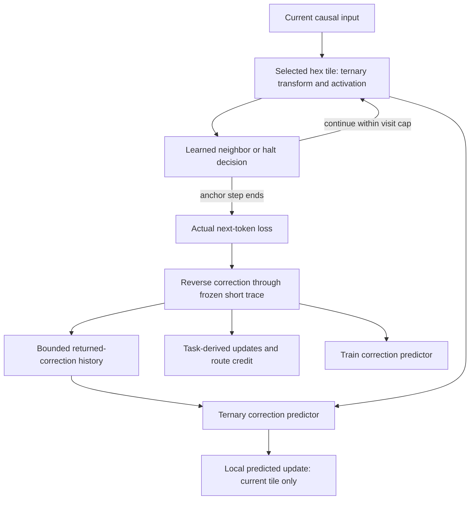

# Ternary pulse: train a small region, keep useful correction

## Intention and provenance

The owner's objective is lower total training time and compute, not merely a
smaller allocation. The motivating sequence was: train individual knowledge
nodes; pass demonstrations and corrections between nodes; learn routing as well
as transformations; allow different resident budgets; make the combined pulse
historically aware; start with ternary parameters rather than quantizing a
finished floating-point model. Bumblebee social learning inspires the sharing
of useful experience; this is not a claim to implement a biological rule.

The destination is scratch learning with PEFT-like working sets. It does **not**
follow that scratch learning will cost as little as adapting a pretrained model.
That is the hypothesis to measure, not a premise.

## What this milestone builds

`hexweave pulse` is a separate tiny numerical protocol. Every learned matrix in
that protocol is ternary from initialization through each update. Packed two-bit
weights never have a floating-point master copy. Signed 16-bit evidence tracks
update directions; only a bounded number of tiles retain that evidence. Shared
learned state is counted separately. Inactive packed tile weights remain in host
memory: this is **not** a disk-streamed or decentralized model.

Activations, transient derivatives and losses still use floating-point arithmetic.
Fixed scales and algorithm constants are not learned weights. Matrix products
decode trits and add, subtract or skip. Scalar references and runtime AVX2 kernels
retain the same accumulation order; see the [measured loops](PERFORMANCE-LOOPS.md).
No GPU or bitwise-only training claim is made. This original pulse path retains
all packed weights; the separate [text path](TEXT-PULSE.md) loads tiles from disk.



These phases run sequentially. No asynchronous overlap, networked nodes,
attention port, original-F parity or numerical fanout is claimed. `smoke` remains
the FP32 attention reference; it has not been relabeled ternary. Exact equations
and version rules live in [the pulse contract](../src/pulse/AGENTS.md).

The predictor currently proposes transform/activation corrections. Routing uses
the history as input but receives its parameter credit from real anchor loss;
a learned predicted-routing-advantage head is not implemented yet. This preserves
an external error anchor instead of allowing every component to certify itself.

## Bounded comparison

After integrated validation builds the binary:

```powershell
python -B -m scripts.pulse_runner --steps 64 --seeds 7 --mode pulse
python -B -m scripts.pulse_runner --steps 64 --seeds 7 --mode anchor-only
```

Both start independently from the same seed and deterministic fixture schedule.
The control removes predicted local updates, not all training. Up to three
specified seeds are independent initializations, not continuing model chunks.
This is a synthetic next-token fixture, not a natural-language benchmark.

Bounds: 1..256 steps, 1..3 resident evidence sets, anchor interval 1..16, at most
three unique seeds, whole-run deadline 1..120 seconds (default 30, plus bounded
child cleanup). Read actual targets, visits, predictor/correction work and state
payload bytes alongside loss and elapsed time. Payload bytes are not peak RSS.

## Monitoring and reporting

The Python runner launches the already-built binary directly, below-normal priority on
Windows, in unique `work/pulse/<id>` directories. It pins the binary hash, checks
the exact child receipt and records events, stdout/stderr and terminal
`report.json`. No server, download or retry occurs. The 1 MiB log threshold is
polled: an overflow detection threshold, not a write-boundary quota.

Create `work/pulse/STOP` to inhibit launches or `work/pulse/<id>/STOP` for one run.
Only the exact owned child is signaled. There is no checkpoint; a forced stop
discards in-memory state. This is not a production cooperative-stop/resume path.
Filesystem failure can prevent receipt persistence; nonzero owner exit remains
a failure. A healthy finite run exits at its bound; it is not disabled mid-run.

The cheaper agent can observe and report to this active parent conversation;
that callback was verified in this task. No automatic wake-up of a closed chat,
startup task or persistent unattended agent is installed. Receipts explicitly
say `native_chat_wakeup: false`. CLI event/final-message output also needs a
consumer to become a notification; see the
[official non-interactive documentation](https://learn.chatgpt.com/docs/non-interactive-mode).

## Next gates

Prove storage/update invariants, frozen-trace correction, target provenance,
version handling, bounded evidence and failure handling first. Then ask whether
the pulse reaches a declared held-out loss with less **total** work than its
anchor-only control. Count predictor training, anchors, replay, movement,
evaluation and scheduling overhead. No speedup, energy reduction or
PEFT-equivalent total pretraining cost is established by a tiny successful run.

Only after measured benefit should this expand to attention, text/tokenizers,
out-of-core storage, heterogeneous adapters, stale-message protocols and real
parallel workers. The 81M/287M planning profiles stay unchanged and unavailable
for training. This fixture cannot forecast their time-to-quality or Granite parity.
