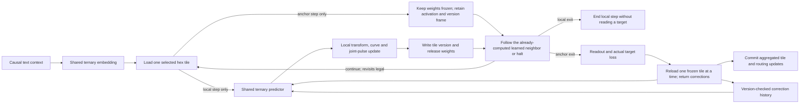

# Disk-local ternary text pulse

## Why this path exists

The owner's central idea is that a small region should learn from its current
input and a historically informed correction, without loading the rest of the
model to manufacture each local update. Routes, transformations and activation
functions should all remain learned. Passing demonstrated corrections between
nodes is inspired by social learning; it does not remove the need for external
task feedback or establish pretraining at PEFT cost.

This experiment makes that locality concrete. Seven tiles occupy a hex grid;
only one tile's packed weights are loaded at a time. Learned neighbor/halt
decisions allow revisits, with a three-visit cap. Every learned coefficient starts
and stays ternary, including three continuous activation-curve knot offsets,
router, embedding, vocabulary readout and correction predictor. Floating-point
activations and surrogate derivatives are still used.

## Entry points and limits

The v2 tile-wide pulse is explained in [Where the training pulse happens](TRAINING-PULSE.md).
It shares learned context across transform gain, curve output shift and routing
bias; all three feed parameter credit into the same ternary context projection.

Read [the source map and equations](../src/text/AGENTS.md), then
[runner.rs](../src/text/runner.rs), [execution.rs](../src/text/execution.rs),
[credit.rs](../src/text/credit.rs), and [storage.rs](../src/text/storage.rs).
The CLI is `hexweave text`; use the owned supervisor for an actual bounded run:

```powershell
cargo build --release --locked --offline
python -B -m scripts.text_runner --steps 256 --seed 7 --mode pulse
python -B -m scripts.text_runner --steps 256 --seed 7 --mode anchor-only
```

This is a **tiny next-byte model**, not the full F architecture: width 16, byte
vocabulary 256, eight-byte causal weighted embedding context, and no attention.
The checked-in data is newly authored public fixture text, not a downloaded
pretraining corpus. Held-out evaluation resets history per example and never
updates weights. The 81M/287M profiles remain plan-only and cannot be launched.



Local updates do not inspect later tile weights or the current target. Anchors
do inspect the selected realized path and compute real task corrections. Thus
inactive portions are blind to **local** updates, not completely disconnected
from task credit. Shared embedding/readout and direct routing-score credit update
at anchors. Local pulse-context updates can also change future route behavior;
the current predictor does not invent independent routing advantage targets.

## What memory is actually bounded

The tile store owns one decoded tile in a closure. Activation traces contain
values and version IDs, not tile weights. A local predicted pass retains no
whole-path activation tape. Shared embeddings, readout, predictor, their evidence,
small data files and bounded correction history remain resident. Serialization
temporarily duplicates bytes for the current tile; OS file-cache eviction is not
controlled. One live tile is an ownership invariant, not a whole-model RAM claim.

The Windows supervisor starts a suspended, below-normal child, assigns a Job
Object before execution, and fails closed if ownership cannot be established.
The intended guard is one child process and 512 MiB child committed-memory caps,
plus sampled RSS/host-availability checks and an adaptive physical host cushion.
The Python owner is outside that job. This is CPU-only; no GPU memory is allocated.
Detailed implementation and actual enforced limits are in the terminal receipt.

Runs are finite (at most 1,024 opportunities, 120-second deadline), with no retry.
STOP requests cooperate at step boundaries; deadline/guard failures may force
termination after a bounded grace. Logs have a polled 1 MiB detection threshold,
not an OS write quota. Versioned tiles, progress, final shared state and receipts
stay under ignored `work/text/`. Artifacts are retained for diagnosis, not removed
automatically. Inspection snapshots **cannot resume training**.

## How to judge the result

Count anchor target tokens separately from predicted updates and step
opportunities. Compare both modes at equal actual target exposure; anchor-only
is a periodic-anchor ablation, **not a standard every-example backprop baseline**.
Read total wall time, training-only time, measured peak child working set,
loads/commits/bytes, and initial/final held-out NLL together. A completed cheap
fixture proves operational feasibility at this scale, not useful language
capability, stable ternary optimization or scalable pretraining efficiency.

The full suite and bounded run receipts are recorded in [STATUS.md](STATUS.md)
and [TEXT-RESULTS.md](TEXT-RESULTS.md). The first v1 runs completed cheaply but
held-out loss worsened in both arms; do not scale on this evidence.
