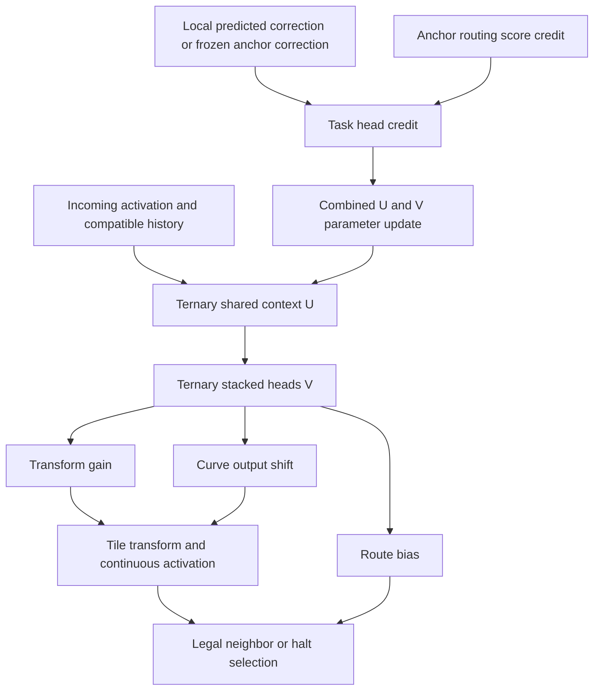

# Where the training pulse happens

**The joint tile pulse lives in [training_pulse.rs](../src/text/training_pulse.rs).**
`TrainingPulse::forward` creates shared context and controls;
[`Gradients::add`](../src/text/gradients.rs) joins task and routing credit, then
`TrainingPulse::add_gradients` projects that combined correction into U/V gradients;
[`Node::apply`](../src/text/node.rs) commits the ternary updates under one version.
This is the training-pulse entry point for the disk-local text experiment,
not a replacement for the separate FP32 smoke or synthetic pulse protocols.

## Intention

The owner's proposal is broader than routing intelligence: the input, compatible
history, transformation, activation curve and route should inform each other.
The pulse is a small learned conditioning model, trained alongside the tile.
The "laser etching" analogy describes a localized parameter update, not a claim
that one bitwise instruction can carry out every forward and training operation.

This first implementation shares a latent representation across three control
heads. It retains learned routing and continuous learned activation curves while
using ternary coefficients from initialization. It does not use a GAN objective:
there is no adversarial generator/discriminator game. Historical correction
demonstrations are compatible bounded inputs, not proof of causality or perfect
long-range credit assignment.

## Forward and learning contract

For input `x`, compatible history `h`, tile transform `W`, pulse context `U`,
and stacked pulse heads `V`, with width `d = 16`:

```text
f = concatenate(x, h)
s = tanh(U f / sqrt(2d))
a = V s / sqrt(d)
gain = 1 + 0.125 tanh(a_gain)
shift = 0.125 tanh(a_curve)
z = (W x / sqrt(d)) * gain + h / 8
y = x + 0.25 (curve(z) + shift)
route_logits = R concatenate(y, h) / sqrt(2d) + 0.25 a_route
```

The curve has learned ternary knot offsets; `shift` modulates its output, not a
discrete choice among activation families. All learned matrices remain ternary;
latent values, scales, activations and surrogate derivatives remain floating point.



Task-derived gain/shift credit and anchor route-score credit join before updating
U/V. Thus the same learned representation receives multiple training signals.
Local predicted updates can change U and therefore future route behavior, even
though direct routing-score credit is anchor-only. The shared correction predictor
is still a separate model trained from real anchor corrections.

Returned task corrections include the transform-gain and pulse-input derivatives.
Routing choices, routing-feature input paths, and history are detached in this
conditional-path derivative. This is not an unbiased full expected-loss gradient
through the discrete routing policy. Anchors freeze all path versions and gather
all corrections before committing; repeated tile visits aggregate before update.

## Execution cost and boundaries

Compatible matrix products reuse the existing scalar/AVX2 kernels. Stacked heads
share a projection, but context, heads, activation and routing remain ordered,
dependent operations. "One pulse" means one logical tile operation, not one CPU
instruction or concurrent GPU execution. The extra matrices add computation;
speed or learning gains must be measured, not inferred from coupling.
The small forward-modulation scales do not make threshold-one signed ternary
updates small learning-rate steps; one update can change many coefficients.

A learning-benefit claim needs a matched coupling ablation. The existing
anchor-only comparison changes local updates/history while retaining U/V in both
arms, so it cannot isolate the shared trunk's benefit. Historical v1 runs also
use a different architecture and cannot supply that comparison.

The store still owns one decoded tile at a time. Shared embedding, readout,
predictor, bounded history and temporary gradients remain resident. The new
protocol is `text-pulse-v3`, with tile schema 2 and inspection snapshot v3.
The [T1 credit contract](T1-CREDIT-EXPERIMENT.md) keeps v2 forward geometry and
initialization unchanged, while explicitly recording coupled or route-to-U-detached
training credit. Historical v1/v2 receipts remain valid historical evidence;
they are not accepted as new v3 runs. Snapshots remain non-resumable.

Not implemented here: learned prefetch/cache control, resource-cost critic,
counterfactual early-exit comparisons, fanout training, a bitwise update-acceptance
gate, GPU kernels, or production resume. The planned 81M/287M profiles remain
plan-only. See [the source contract](../src/text/AGENTS.md) and
[status](STATUS.md) for measured evidence and remaining gates.
