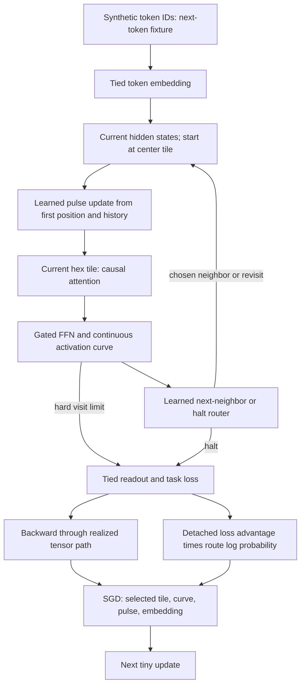

# Architecture: learned paths through a hex mesh

## Executable boundary

This document describes the original FP32 `smoke` reference. The ternary
byte-level causal candidate and its core training path are mapped in
`src/causal/AGENTS.md`; the archived `pulse` protocol is in
[TERNARY-PULSE.md](../archive/docs/TERNARY-PULSE.md). Neither replaces these
semantics.

The seed separates a numerical CPU fixture from a larger-model plan. It uses
Rust and Candle 0.11.0 automatic differentiation. No Python tensor environment,
GPU dependency, model artifact or parent checkpoint is copied into this repo.

The diagram is a learning loop, not a claim that all blocks train concurrently.
All seven tiny tiles are resident in the FP32 fixture, the archived pulse
protocol and the core training path. Sparse execution is not sparse residency.
The archived [disk-local text protocol](../archive/docs/TEXT-PULSE.md) loaded one
tile at a time, with shared state retained and OS file-cache behavior explicitly
outside its contract.

## Geometry and routing

A radius `r` axial mesh has `1 + 3r(r+1)` tiles. Integer `(q, r)` coordinates give
stable tile identities and at most six immediate neighbors. Revisiting a tile is
legal. The initial topology does not add learned long-range edges.

The metadata planner also supports stop, one successor or two distinct legal
successors. Depth, frontier and total visits have separate hard limits. Exits
carry normalized branch mass; an exhausted budget finishes existing work rather
than silently losing a branch. FIFO budget assignment is order-biased. This is
not the older Hex Lab's equal-leaf mean or symmetric frontier quota, and this
planner does **not** implement tensor fanout or a numerical merge gradient.

The numerical fixture uses one route for the entire tiny sequence. Its route
features must only depend on the first token's state and corresponding pulse;
using a sequence mean would leak future tokens into earlier predictions. Causal
attention alone would not prevent that leak. Full F-style per-token routing is
not implemented.

## Transformation and credit

Each selected tile has Q/K/V/O attention matrices and a three-matrix gated FFN.
Continuous curve parameters and a learned pulse are trained through the realized
path. Hard route actions use a score-function policy term with detached loss
advantage; they are not differentiated through an argmax index.

The pulse recurs within a trajectory and carries one detached terminal state
into the next training example. Evaluation resets that history. A future
versioned memory of completed transformations and returned corrections must distinguish activations,
observed evidence and predicted targets. Stale records need source/destination,
weight-version and age metadata. A single shared vector without these boundaries
does not establish causal credit across independently trained nodes.

The initial seed is FP32, uses backpropagation for its reference and keeps all
tiny parameters in memory. It does not implement a GAN, adversarial discriminator
training, packed ternary arithmetic, a ternary optimizer, or backprop-free TPT.

## F compatibility table

| Property | Seed | Original F / future port |
| --- | --- | --- |
| Route topology | Hard immediate hex-neighbor choices and halt | Original global bank action space, wait/halt semantics |
| Routing granularity | One first-token-conditioned route per sequence | Per-token private controller state |
| Activation curve | Directly trainable continuous curve | Detached sampled Gaussian knot actions and policy score |
| Attention context | Full causal sequence at each selected tile | Synchronous immutable published prefix per routing round |
| Post-actions | Not implemented | FULL / RETAIN / REJECT |
| Credit | Task backprop plus route score term | Original policy/calibration/counterfactual objective |
| Pulse history | Recurrent state plus one detached prior terminal pulse | Proposed versioned demonstrated correction history |
| Fanout | Bounded metadata planner | Tensor branch execution and exact merge adjoints still needed |
| Residency | All tiny weights resident | Future bounded resident tiles and gradient/optimizer storage |

## Size model

For tied vocabulary `V`, width `d`, FFN width `m` and `N` tiles, the dominant
parameter estimate is:

`P_main = V*d + N*(4*d*d + 3*d*m)`

The four matrices are Q/K/V/O; the three FFN matrices are gate/up/down. This
excludes auxiliary router, pulse, curve and normalization weights unless a
specific implementation count is reported. A 16-byte/main-parameter planning
allowance covers FP32 weights, gradients and two optimizer moments, not the
smoke fixture's actual SGD allocation. It is neither measured RSS nor a peak
CUDA estimate. Future optimizer changes require a new ledger.

For the 287M profile, context starts at 256, microbatch at one and numerical
fanout remains unavailable. Its `fanout=true` setting enables only metadata
planning; no larger-profile tensor executor exists. Larger context, multiple residents and branching are
separate admission changes, not free consequences of the parameter count.

## How to investigate the bottleneck

Record task targets once, tile visits separately, pulse work, correction work,
activation lifetime, bytes transferred, optimizer time and checkpoint time.
Compare pulse on/off and topology/fanout controls with identical data and
initialization under a declared exposure or compute budget. Then compare held-out
quality against elapsed time. No FLOPS estimate alone answers whether training is
tenable on the local machine.

## Decisions to revisit

Rust/Candle supplies an inspectable tensor reference; it does not itself prove
faster routing kernels. Immediate hex neighbors make locality explicit but may
restrict useful routes. Sequence-level routing keeps the seed small but weakens
contextual choices. FP32 provides an understandable reference before precision
changes. All four decisions are reversible only through separately named,
tested protocol changes. See [STATUS.md](STATUS.md) for the readiness gates and
[SOURCES.md](SOURCES.md) for source provenance.
